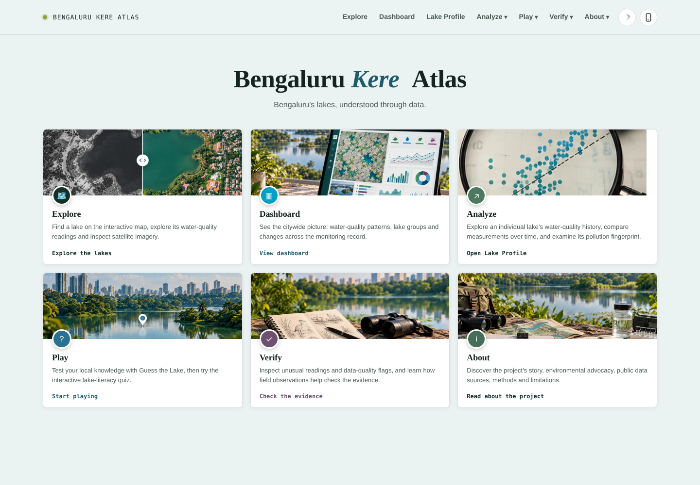
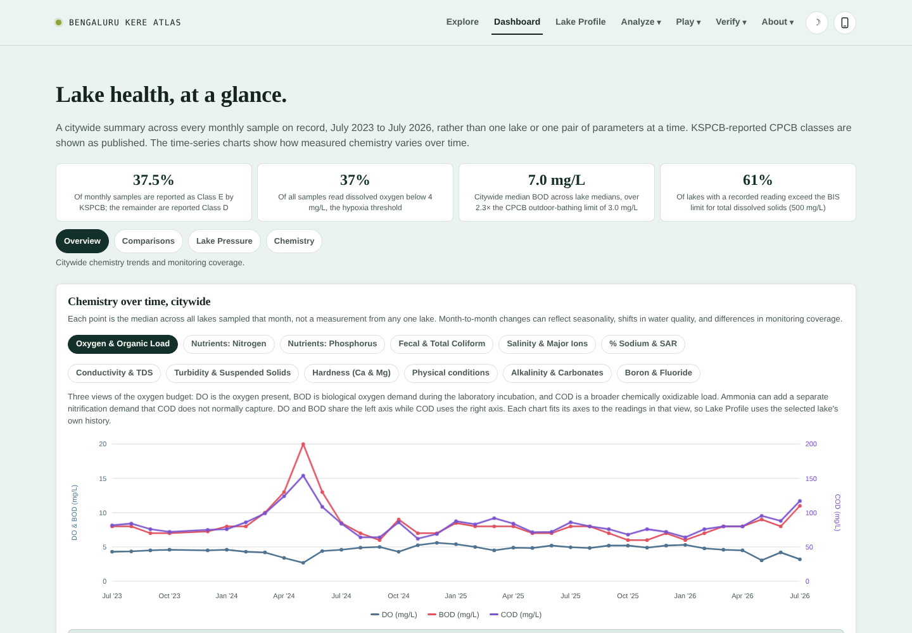
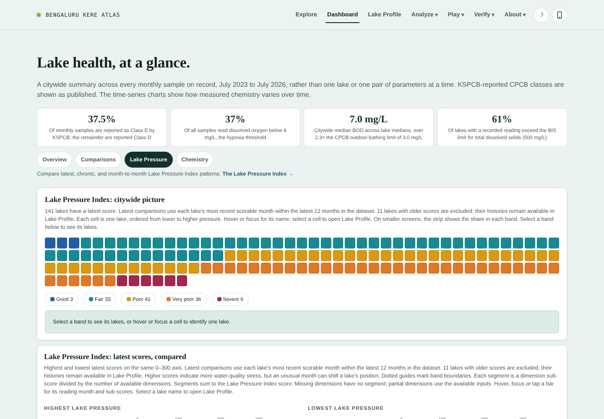
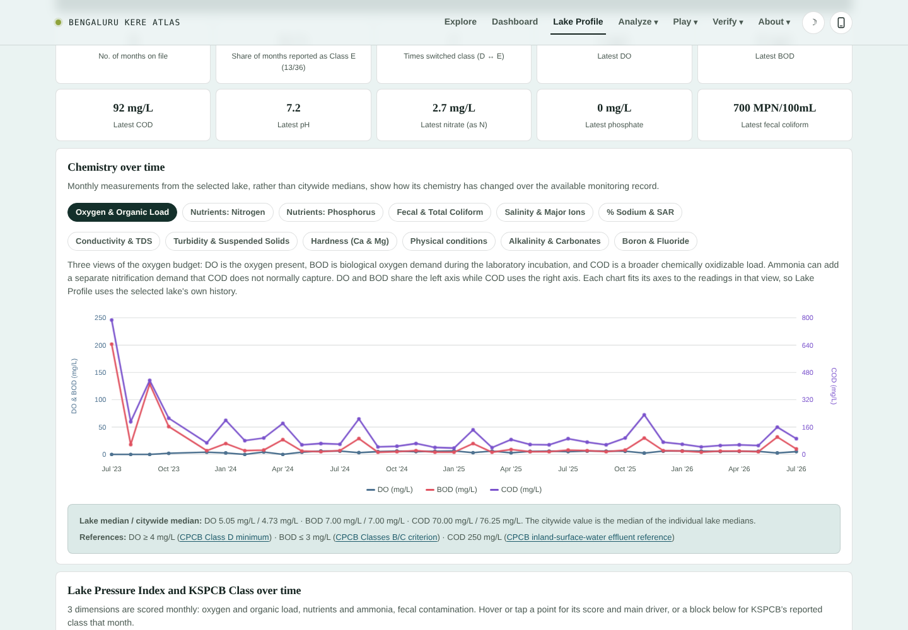
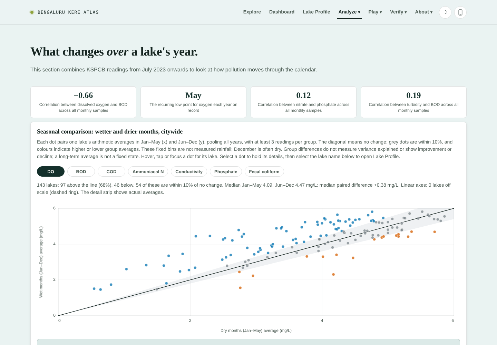
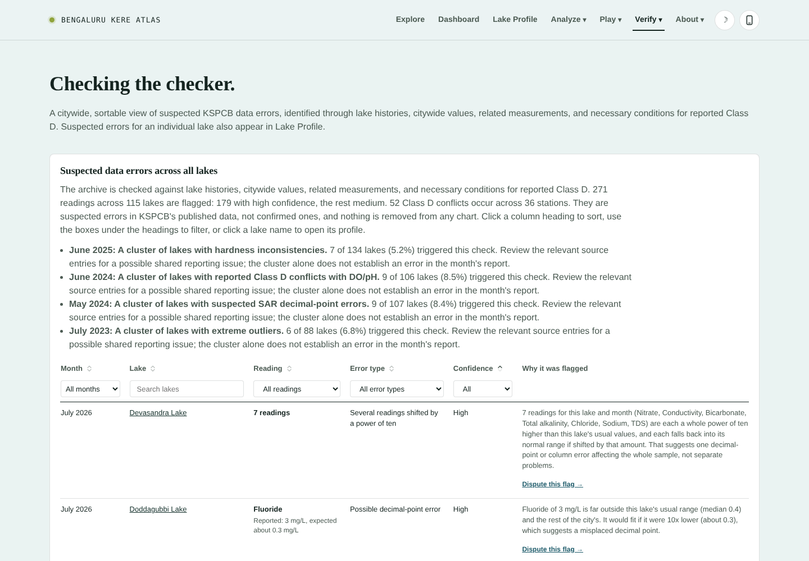
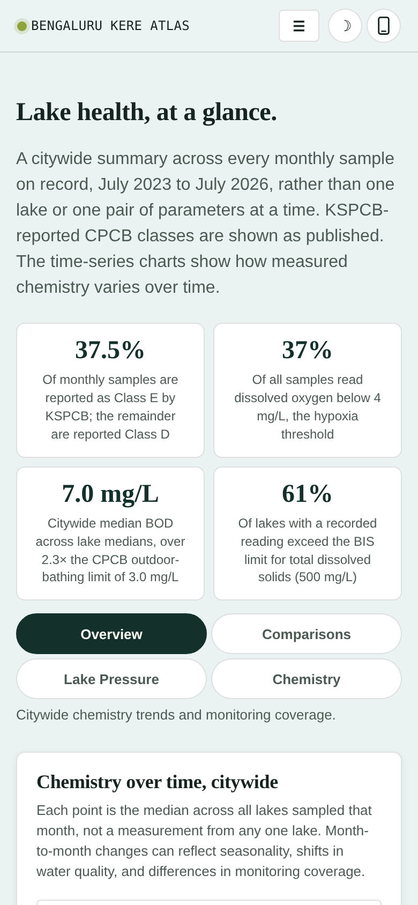

# BengaluruKereAtlas

[](https://doi.org/10.5281/zenodo.XXXXXXX)


**Bengaluru Kere Atlas: Bengaluru's lakes, understood through data.**

**Live site: <https://adityaratnam09.github.io/BengaluruKereAtlas/>**

---

## Overview

> **Urban Lake Water Quality in Bengaluru: A Data-Driven Typology**

The Karnataka State Pollution Control Board (KSPCB) publishes monthly water-quality
measurements for Bengaluru's lakes as PDF reports whose layouts change from month to
month, which makes it hard to compare one lake with another or one month with the next.
Bengaluru Kere Atlas ("kere" is the Kannada word for lake) turns those reports into an
interactive atlas of 150+ lakes, built from monthly KSPCB reports back to July 2023 and
updated as each new report is published.

The analysis behind it finds one dominant oxygen-depletion gradient across the lakes:
lower dissolved oxygen occurs alongside higher oxygen demand, ammoniacal nitrogen,
nutrients, dissolved ions and fecal contamination. The accompanying paper describes the
typology, its uncertainty and the data-quality audit for the record available when it was written.

---

## What the atlas does

Bengaluru Kere Atlas is one self-contained web page with seven sections. It runs entirely
in the browser, with no server of its own and no account to create. Everything shown is drawn
from the harmonized KSPCB record, and every chart says what it can and cannot show.

### Explore: find a lake and read its water

- **Interactive map** of KSPCB-monitored lakes, with search and a full lake list. Markers
  can be coloured by CPCB designated-best-use class (A to E) or by the **Lake Pressure
  Index**, with a minimum-score filter, and the map can show all lakes or only lakes that
  have no KSPCB reading.
- **Satellite compare**: a side-by-side slider between two dated satellite releases from
  Esri's World Imagery Wayback archive, both chosen from the monsoon season so the
  comparison is not distorted by dry-season versus wet-season differences.
- **Follow a drop of water**: an animated walk down the documented Hebbal-Nagavara cascade
  of seven connected lakes, from Kattigenahalli Lake to Yelemallappa Shetty Lake, with the
  latest KSPCB readings at each monitored stop. The paths are schematic, and the readings
  are individual lake measurements, not measurements of water flowing between lakes.
- **Plain-language explainers** for the CPCB Class A to E thresholds and for how the Lake
  Pressure Index combines three pressure dimensions into one screening score.
- **Lakes watched**: star lakes from their profile to keep a shortlist on the home page,
  saved in your own browser only.

### Dashboard: the citywide picture

- Headline figures: the share of samples with dissolved oxygen below the 4 mg/L hypoxia
  threshold, citywide median BOD against the CPCB outdoor-bathing limit, and the share of
  lakes exceeding the BIS limit for total dissolved solids.
- **Chemistry over time**: citywide monthly medians, plus monitoring coverage by month so
  changes in sampling effort are visible.
- **Lake Pressure Index views**: the citywide picture, latest scores compared, and
  historical pressure and variability.
- **Leaderboards and distributions**: dissolved oxygen best and worst off, lakes with the
  highest median BOD, the cloudiest lakes (turbidity), chronic hypoxia (share of months
  below 4 mg/L), COD:BOD ratio, fecal coliform, ammoniacal nitrogen versus nitrate, total
  dissolved solids across lakes, pH against the CPCB Class D band, irrigation suitability
  (sodium adsorption ratio), and heavy metals against IS 10500 reference limits.

### Lake Profile: one lake, every reading on file

Pick any lake to see its full monthly history next to its latest snapshot from Explore,
and any suspected data errors recorded for it.

### Analyze: seasons and relationships

- **Seasonal**: how pollution moves through the calendar. It compares wetter (June to
  December) and drier (January to May) months for dissolved oxygen, BOD, TDS, turbidity,
  hardness, nitrate and phosphate, and shows the recurring pre-monsoon oxygen low point.
- **Correlate**: plot any two of 21 curated water-quality parameters against each other,
  one dot per lake, using either each lake's latest reading or its average over its full monitoring history. Also
  includes a pooled correlation view across all monthly samples, a dissolved-oxygen versus
  BOD quadrant that separates lakes under stress from healthier ones, and a nitrate versus
  phosphate quadrant for nutrient enrichment.

### Play: learn the lakes

**Guess the Lake** tests local knowledge of Bengaluru's lakes, and a **Quiz** tests lake
literacy.

### Verify: check the evidence

- **Data Errors**: a citywide, sortable table of suspected reporting errors in the KSPCB
  data, found by comparing each lake's own history, citywide distributions, related
  measurements and necessary conditions for reported Class D. Each flag carries a
  confidence level and a reason. Flagged readings are never silently removed.
- **Field Notes**: a log for volunteers standing at a lake with a test strip and a phone.
  Date, lake and notes are required; temperature, pH, dissolved oxygen, TDS, hardness and
  Secchi depth are optional. Entries stay in your browser and can be sorted or cleared.
  Alongside it, simulated sliders show what low-cost field tools (pH strip, TDS pen,
  hardness strip, Secchi disk, dissolved-oxygen kit, thermometer) would read, with
  indicative prices in rupees.

### About: context and method

The story of Bengaluru's lake network and how it was lost to encroachment, with figures
drawn from published sources rather than calculated here; a Chemistry Lens page; and full
sources, methods and limitations. The page also has a dark mode and a phone-sized
preview.

### Built-in safeguards

- Suspect readings are flagged and explained, not deleted.
- Charts state what they measure and what they do not, for example that turbidity is not
  pollution and that seasonal patterns are associations, not causes.
- Regulatory thresholds (CPCB classes, BIS and IS 10500 limits) are shown as fixed
  references, separate from statistical patterns.
- A lake with no matching KSPCB record is marked as unmonitored, never as clean or
  polluted.
- Data refreshes monthly as KSPCB publishes new reports.

---

## Screenshots

**Landing page**

<p align="center">
  
</p>

**Dashboard: lake health at a glance**

<p align="center">
  
</p>

**Lake Pressure Index: one cell per lake, banded from Good to Severe**

<p align="center">
  
</p>

**Lake Profile: every reading on file for a single lake**

<p align="center">
  
</p>

**Seasonal comparison: wetter versus drier months, lake by lake**

<p align="center">
  
</p>

**Data errors: suspected reporting errors across all lakes**

<p align="center">
  
</p>

**Mobile layout**

<p align="center">
  
</p>

---

## What is in this repository

```text
BengaluruKereAtlas/
├── index.html      # the atlas: one self-contained page, served by GitHub Pages
├── README.md
├── LICENSE
└── screenshots/
```

The data-extraction and analysis code is not published here. It is available from the
author on reasonable request.

---

## License and use

Copyright (c) 2026 Aditya Rajiv Ratnam. All rights reserved. The atlas is published for
viewing and citation. Please do not copy, modify or redistribute the page, its design or
the compiled dataset without written permission; see [LICENSE](LICENSE). The underlying
KSPCB reports are public documents of the Karnataka State Pollution Control Board.

---

## Citation

```text
Ratnam, A. R. (2026).

Bengaluru Kere Atlas [Web application].

https://adityaratnam09.github.io/BengaluruKereAtlas/
```

**Paper**

```text
Ratnam, A. R. (2026).

Urban Lake Water Quality in Bengaluru: A Data-Driven Typology.

Zenodo.

https://doi.org/10.5281/zenodo.XXXXXXX
```
